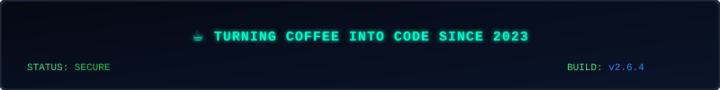

<!-- 🌟 HEADER SECTION (Auto-running Terminal SVG) 🌟 -->

  

  

  

 
<!-- 👨‍💻 INTRO & ANIMATION SECTION -->

  <table>
    <tr>
      <td align="center" width="30%">
        
      </td>
      <td align="left" width="40%">
        <h2>Hi there! 👋 I'm Dulana</h2>
        
I blend <b>logical problem-solving</b> with <b>aesthetic UI/UX</b> to build robust software systems. Currently mastering Full-Stack Development while diving deep into the world of AI/ML.

        
🎓 <b>Undergrad:</b> University of Kelaniya '29 
        🎯 <b>Goal:</b> 2027 SE / AI-ML Internship 
        💡 <b>Philosophy:</b> "Code is poetry, logic is art."

      </td>
      <td align="center" width="30%">
        
      </td>
    </tr>
  </table>

<!-- 🌐 SOCIAL CONNECT & RESUME -->

  
  
  
  
  

<!-- 📄 FEATURED RESUME / CV BUTTON -->

  

 

<!-- 🚀 TECH ARSENAL (MODERN SKILL ICONS) -->
<h2 align="center">⚡ My Tech Arsenal</h2>

  
    
  
    
  

 

<!-- 🏗️ FEATURED PROJECTS (BENTO BOX GRID UI) -->
<h2 align="center">🔥 Featured Engineering Projects</h2>

  <table>
    <!-- Row 1: Real-Time AI & HealthTech -->
    <tr>
      <td width="50%" valign="top">
        <h3><b>🎙️ VoxBridge AI System</b></h3>
        
An advanced, low-latency, real-time speech-to-speech interpreter that captures system audio from live streams and meetings. Powered by Google Gemini 2.5 Flash with dynamic VAD chunking and automatic audio ducking.

        

          
          
          
          
          
        

         
        <a href="https://github.com/dulanachathurma/Realtime-Live-Videos-Translator">🔗 <b>View Source Code</b></a>
      </td>
      <td width="50%" valign="top">
        <h3><b>🏥 HealthPulse AI — Mobile & Web Companion</b></h3>
        
A full-stack trilingual (English, Sinhala, and Tamil) health platform featuring real-time BMI analytics, symptom-based doctor recommendations, health vitals tracking, and persistent user profile management.

        

          
          
          
          
          
        

         
        <a href="https://github.com/dulanachathurma/Vitacare-mobile-fullstack">🔗 <b>View Source Code</b></a>
      </td>
    </tr>

<!-- Row 2: Cloud-Native Engineering & Operating Systems -->
<tr>
  <td width="50%" valign="top">
    <h3><b>🌌 AstroPulse-AIOps Observability Gateway</b></h3>
    
A cloud-native integration gateway built with Ballerina and Python that uses Claude AI to analyze microservice telemetry logs and generate real-time automated Root Cause Analysis (RCA).

    

      
      
      
      
      
    

     
    <a href="https://github.com/dulanachathurma/AstroPulse-AIOps">🔗 <b>View Source Code</b></a>
  </td>
  <td width="50%" valign="top">
    <h3><b>💻 Bare-Metal x86 Operating System</b></h3>
    
A custom-built bare-metal x86 operating system featuring a bootloader, round-robin process scheduler, multithreading, physical memory management (PMM and heap), and a RAM disk file system.

    

      
      
      
      
    

     
    <a href="https://github.com/dulanachathurma/seng21213-os">🔗 <b>View Source Code</b></a>
  </td>
</tr>

<!-- Row 3: Computer Vision & AI -->
<tr>
  <td width="50%" valign="top">
    <h3><b>🖐️ AuraTouch AI System</b></h3>
    
A team-based AI computer vision system for touchless desktop navigation and mouse control through real-time hand gesture tracking. My role focused on computer vision and gesture mapping.

    

      
      
      
      
    

     
    <a href="https://github.com/dulanachathurma/AI-Gesture-Mouse">🔗 <b>View Source Code</b></a>
  </td>
  <td width="50%" valign="top">
    <h3><b>👁️ VisionScope AI Fullstack</b></h3>
    
An AI-powered human feature detection web application with real-time webcam processing and image upload capabilities.

    

      
      
      
      
    

     
    <a href="https://github.com/dulanachathurma/VisionScope-AI-Fullstack-Project">🔗 <b>View Source Code</b></a>
  </td>
</tr>

<!-- Row 4: Full-Stack Management Systems -->
<tr>
  <td width="50%" valign="top">
    <h3><b>🚗 AutoPartsLanka — Spare Parts System</b></h3>
    
A full-stack vehicle spare parts e-commerce and management system designed to streamline inventory, product catalog, and order processes.

    

      
      
      
      
    

     
    <a href="http://autopartslanka.wuaze.com/">🔗 <b>Visit Live Website</b></a>
  </td>
  <td width="50%" valign="top">
    <h3><b>📝 Task-Flow — MERN App</b></h3>
    
A modern, responsive full-stack task management application featuring JWT authentication and priority-based task sorting.

    

      
      
      
      
    

     
    <a href="https://github.com/dulanachathurma/Task-Flow">🔗 <b>View Source Code</b></a>
  </td>
</tr>

<!-- Row 5: Services & Platforms -->
<tr>
  <td width="50%" valign="top">
    <h3><b>🐾 Pet Care Management System</b></h3>
    
A full-stack web application for booking and managing pet care services, including grooming, bathing, and veterinary care.

    

      
      
      
      
    

     
    <a href="https://github.com/dulanachathurma/Pet-Care-System">🔗 <b>View Source Code</b></a>
  </td>
  <td width="50%" valign="top">
    <h3><b>✨ SriSeta Astrology Platform</b></h3>
    
A modern astrology service platform with an interactive user experience, responsive layouts, and smooth animations.

    

      
      
      
    

     
    <a href="https://sriseta.vercel.app/">🔗 <b>Visit Website</b></a>
  </td>
</tr>

<!-- Row 6: Portfolio -->
<tr>
  <td colspan="2" width="100%" valign="top" align="center">
    <h3><b>👨‍💻 Personal Portfolio</b></h3>
    
My personal portfolio website showcasing my software engineering projects, technical skills, and development experience through a clean, responsive interface.

    

      
      
      
    

     
    <a href="https://dulanaportfolio.vercel.app/">🔗 <b>Visit Portfolio</b></a>
  </td>
</tr>
  </table>

<!-- 📊 GITHUB ANALYTICS -->
<h2 align="center">📊 GitHub Analytics</h2>

<code>dulana@fedora:~$ gh telemetry --render-matrix</code>

    
    
  

<!-- ⏱️ WAKATIME SVG BUTTON -->
 

  

<!-- 🐍 CONTRIBUTION SNAKE -->
<h2 align="center">🌌 Contribution Galaxy (Snake)</h2>

  <picture>
    <source media="(prefers-color-scheme: dark)" srcset="https://raw.githubusercontent.com/dulanachathurma/dulanachathurma/output/github-contribution-grid-snake-dark.svg">
    <source media="(prefers-color-scheme: light)" srcset="https://raw.githubusercontent.com/dulanachathurma/dulanachathurma/output/github-contribution-grid-snake.svg">
    
  </picture>

<!-- 🌟 FOOTER -->
<h2 align="center">✍️ Random Dev Quote</h2>

  <i>"First, solve the problem. Then, write the code." – John Johnson</i>

 

  

